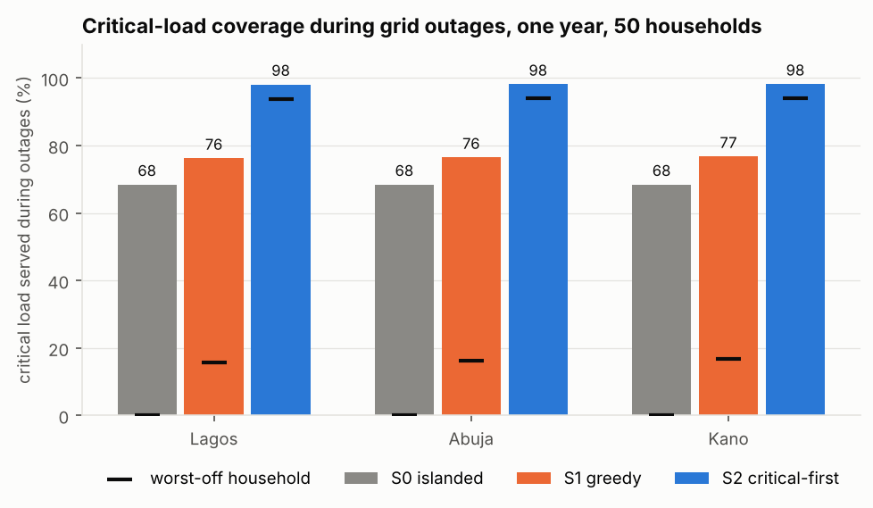
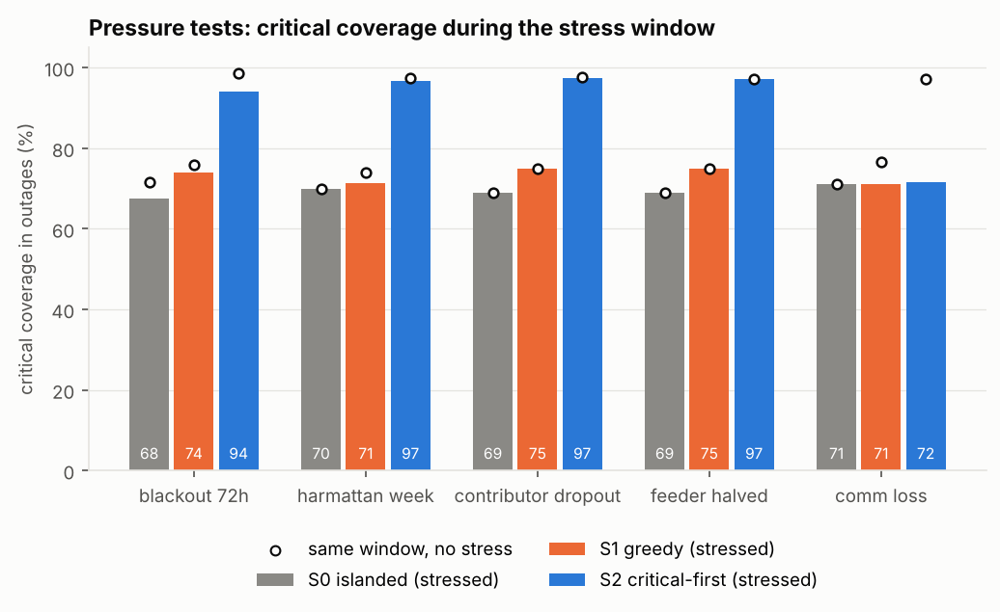

# vicinia

Simulation and settlement engine for neighbourhood solar energy sharing in
Nigeria. Entry to HACK4EARTH 2.0, RESILIENT track.

## The problem

Grid supply in many Nigerian neighbourhoods is unreliable: feeders are
banded by the regulator at 4 to 20 hours of supply a day and often deliver
less. Homes with rooftop solar and batteries regularly have surplus energy
they cannot use, while neighbours without solar run petrol generators for
lights, fans, a fridge and phone charging. Some run them for medical devices.

vicinia models a local sharing scheme. During grid outages, surplus from
solar homes is routed to neighbours, critical loads first, and every
transfer is settled on a tamper-evident ledger. The question it answers:
how much does local sharing improve critical-load coverage and cut generator
fuel and emissions during outages, and does it degrade safely under stress?

## Quick start

```bash
git clone https://github.com/marvinoka4/vicinia && cd vicinia
python3.11 -m venv .venv && . .venv/bin/activate
pip install -e ".[test]"
vicinia compare --scenario scenarios/baseline_lagos.yaml
make reproduce   # regenerates every table and figure in results/ (about 7 minutes)
```

Open `results/report.html` in a browser for the demo report. It is a single
static file with no server or network access needed.

Other commands:

```bash
vicinia simulate --scenario scenarios/stress_blackout_72h.yaml --strategy S2 --out out/
make test         # pytest, including hypothesis property-based tests
make smoke        # shortened reproduce run, writes to results/_smoke
make check-dashes # style check used in CI
```

## What it does

- **Households** with PV (kWp), batteries (capacity, power, efficiency,
  minimum state of charge), loads split into critical and non-critical, and
  optional petrol generators. Four synthetic archetypes: solar plus battery,
  inverter battery only, grid only, and a home with a medical device.
- **Solar** from pvlib clear-sky irradiance for Lagos, Abuja or Kano, with a
  seeded stochastic sky factor for cloud, rainy-season overcast and
  harmattan dust. An optional PVGIS TMY fetcher is included.
- **Grid** availability from NERC supply-hour bands, random load-shedding
  blocks, feeder faults and multi-day grid collapses.
- **Strategies**, run every 15 minutes for up to a year:
  - S0 islanded: own PV and battery, then generator.
  - S1 greedy: PV surplus goes to whole household deficits in arrival order.
  - S2 critical-first: PV surplus goes pro-rata to critical deficits, then
    non-critical; batteries keep a reserve for their own critical load and
    offer energy above it to neighbours' critical deficits.
  - A shared feeder limit (default 25 kW) and distribution losses (default 5%).
- **Settlement ledger**: every transfer is an entry (interval, from, to, kWh
  sent, kWh received, price, amount), SHA-256 hash-chained, with `verify()`,
  per-day netting and per-household statements. Amounts are in integer kobo
  so netting is exact.
- **Pressure tests**: 72-hour blackout, a cloudy harmattan week, the largest
  solar contributor dropping out, feeder capacity halved, and communication
  loss with fallback to islanded operation.

## Results

All numbers below come from `make reproduce` (fixed seeds) and are in
`results/`. Inputs are synthetic, so read them as model results, not
measurements. Full write-up: [results/REPORT.md](results/REPORT.md).

**Lagos, 50 households, one year, 15-minute steps** (Band C feeder, grid on
about 51% of the time):

| Strategy | Critical coverage in outages | Worst-off household | Generator fuel (L/yr) | CO2 (t/yr) | Energy shared (kWh/yr) | Households worse off than S0 |
|---|---:|---:|---:|---:|---:|---:|
| S0 islanded | 68.4% | 0.0% | 25,684 | 58.3 | 0 | n/a |
| S1 greedy | 76.2% | 15.7% | 22,396 | 50.8 | 4,557 | 0 |
| S2 critical-first | 98.1% | 93.8% | 18,053 | 41.0 | 13,447 | 0 |

- S2 cuts generator fuel by 29.7% against islanded operation (17.3 t CO2
  per year for 50 homes). Over five seeds the cut ranges from 23.6% to 32.9%
  and S2 critical coverage from 98.1% to 99.0%.
- Without counting generators, S2 meets 96.3% of critical load in outages
  from PV, batteries and sharing, against 42.2% islanded. A lossless pooled
  reference with the same equipment reaches 100%, so the remaining gap is
  from losses, inverter limits and the battery reserve, not lack of energy.
- Ablations: the S2 battery reserve on its own (no sharing) gives 68.8%,
  and S2 without battery sharing gives 76.9%. Most of the S2 gain comes from
  routing stored energy above the donor's reserve to neighbours' critical
  loads.
- Results for Abuja and Kano are within 0.5 points of Lagos on coverage.
  All three use the same fleet, loads and grid schedule, so only the solar
  resource differs; outage deficits are mostly at night, when storage, not
  PV, is the limit.

**Pressure tests** (critical coverage during the stress window, S0 / S1 / S2):

| Test | S0 | S1 | S2 | S2 without the stress |
|---|---:|---:|---:|---:|
| 72-hour total blackout | 71.4% | 78.3% | 93.3% | 98.8% |
| Harmattan week, irradiance at 40% (Kano) | 71.2% | 78.7% | 98.0% | 98.6% |
| Largest solar contributor drops out | 72.7% | 82.0% | 98.3% | 98.4% |
| Feeder capacity halved | 72.3% | 83.9% | 99.5% | 99.5% |
| Communication loss, 48 h | 71.4% | 71.4% | 72.0% | 98.3% |

Sharing never did worse than islanded under any stress. During
communication loss there are no transfers and no ledger entries; every home
falls back to its own PV, battery and generator, which is the safe outcome
and equals S0. Halving the feeder had no effect because peak transfers were
7.4 kW, below the halved 12.5 kW limit. Over the full year the peak was
7.9 kW; at a 5 kW limit S2 coverage falls only from 98.1% to 97.8%.

**Ledger**: the Lagos S2 run writes 786,978 hash-chained entries;
`verify()` passes, altering one entry is detected at that entry, and daily
netting balances to 0 kobo.

**Runtime**: one simulated year for 50 households takes 2.7 s (S0), 4.5 s
(S1) and 10.4 s (S2) on one CPU core of the build machine
(`results/runtime.csv`). A full `make reproduce` takes about 7.5 minutes.




Two parameter choices were made after looking at the sensitivity sweep, and
both sweeps are published. First, the S2 battery reserve was lowered from
50% to 30%: higher reserves lowered coverage, including in the blackout
test. Second, battery-sourced energy is priced at 1,200 NGN/kWh against
600 NGN/kWh for PV surplus. With a single 600 NGN/kWh price, 3 solar-battery
donors ended the year worse off than islanded; at 1,200 NGN/kWh none did.

## Tests

`make test` runs 44 tests. Property-based tests (hypothesis) generate
random small neighbourhoods and check, for every strategy and every
interval:

- energy balance per household (sources equal uses);
- energy sent minus losses equals energy received;
- battery state of charge follows the recorded flows and stays within its
  bounds;
- the feeder limit is never exceeded and no household receives more than its
  deficit;
- the ledger reproduces the physical transfers, verifies, nets to zero, and
  any altered entry fails verification at that entry;
- runs are deterministic for a fixed seed, and sharing without communication
  is identical to islanded operation.

Scenario tests check the pressure tests: sharing never does worse than
islanded under stress, the ledger stays valid, and during communication
loss there are no transfers or ledger entries.

## Repository layout

```
src/vicinia/   engine, solar, loads, grid, sharing, ledger, metrics, CLI, report
scenarios/     YAML scenarios (three baselines, five pressure tests)
tests/         pytest and hypothesis tests
results/       generated tables, figures, REPORT.md and report.html
docs/          assumptions.md, limitations.md, img/ (report screenshots)
scripts/       PVGIS fetcher, em dash check, report screenshots
```

## Limitations

All inputs are synthetic: load profiles, fleet, weather factor and grid
schedule. Nothing has been validated against field data. The electrical
model is energy-only (a single feeder limit and a flat loss, no power flow),
and it assumes the inverters can form a safe island during outages. See
[docs/limitations.md](docs/limitations.md) and
[docs/assumptions.md](docs/assumptions.md), where every parameter is
listed with its source.

## Next steps

1. Replace synthetic loads with metered data from a pilot estate and fit the
   archetypes to it.
2. Run with PVGIS TMY or measured irradiance for each site.
3. Add an AC power-flow check (for example with pandapower) for a real
   feeder layout.
4. Add a forecast-aware S2 that plans battery reserves ahead of known
   load-shedding schedules.
5. Publish the ledger head hash to all members each day so no single
   operator can rewrite history.

## Licence

Apache-2.0. See [LICENSE](LICENSE). Data sources and their terms are listed
in [docs/assumptions.md](docs/assumptions.md).
