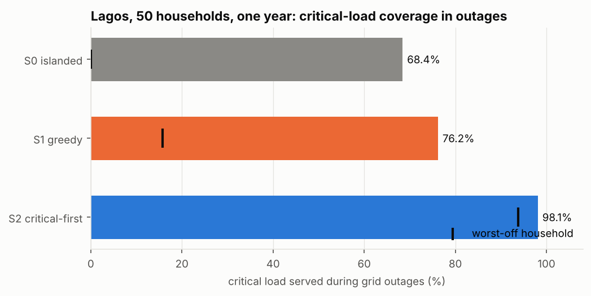
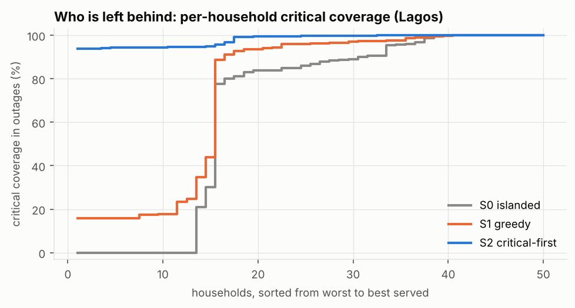
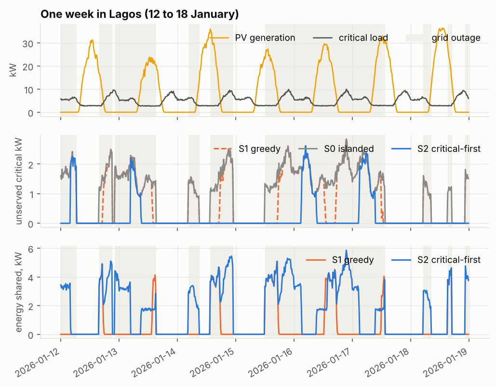
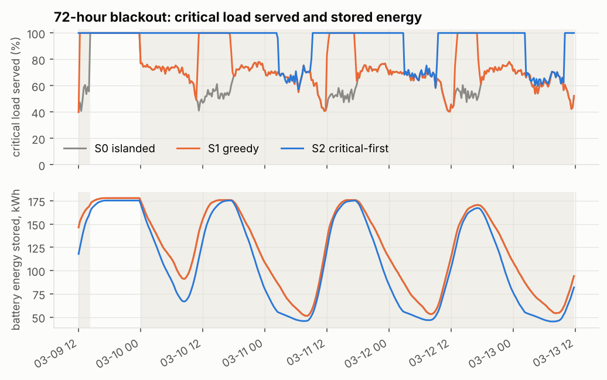
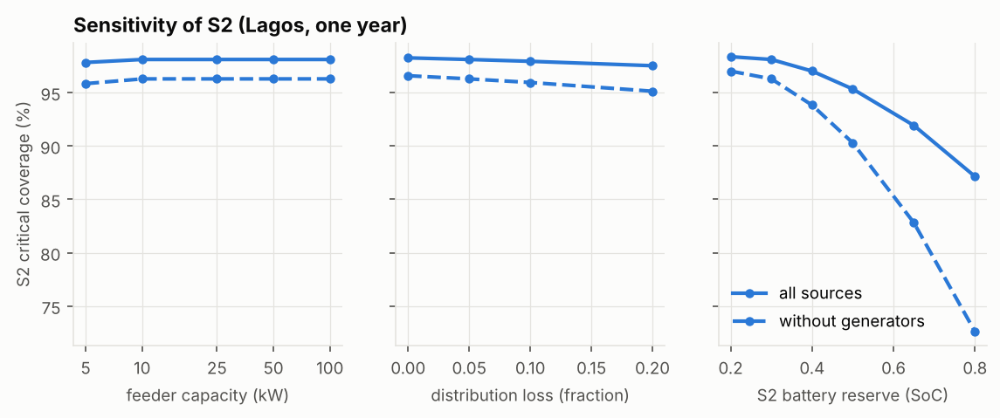
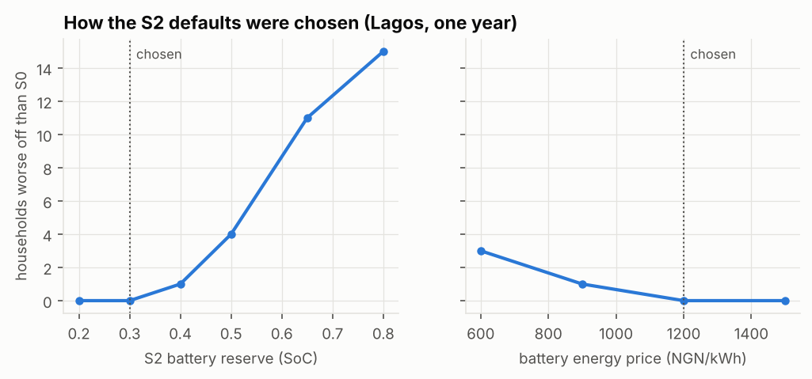

# vicinia results

All inputs are synthetic (see docs/assumptions.md). These are model results, not field measurements.

## Headline: Lagos, 50 households, one year

- Critical-load coverage during grid outages: S0 islanded 68.4%, S1 greedy 76.2%, S2 critical-first 98.1%.
- Worst-off household's critical coverage: S0 0.0%, S1 15.7%, S2 93.8%.
- Generator fuel: S0 25,684 L, S1 22,396 L (12.8% less), S2 18,053 L (29.7% less), which is 17.3 t CO2 avoided per year with S2.
- Critical coverage from PV, batteries and sharing alone (no generator): S0 42.2%, S2 96.3%, against 100.0% for a lossless pooled reference with the same equipment.
- The S2 battery reserve without sharing (S2-local) gives 68.8%, and S2 without battery sharing gives 76.9%, so most of the S2 gain comes from routing stored energy to neighbours' critical loads.
- Households worse off than under islanded operation over the year: S1 0, S2 0 of 50. Gini of benefit: S1 0.26, S2 0.27.
- Across all seeds and pressure tests, S2 left between 0 and 17 households worse off than islanded, all solar-battery donors (see Robustness below).
- Settlement ledger for S2: 786,978 hash-chained entries, verify() = True, altering one entry detected = True, largest daily netting imbalance = 0 kobo.
- Runtime for the Lagos run (365 days, 15-minute steps, 50 households): 12.6 s or less per strategy on x86_64 CPython 3.11.17.
- Abuja and Kano runs, with the same fleet, loads and grid schedule, give near-identical results because shortfalls fall mostly at night, so battery capacity and outage timing dominate irradiance.
- Costs use petrol at 1,596 NGN/L (NBS average, May 2026). The fuel price affects only NGN figures, not coverage or fuel volume.

## Strategy comparison, Lagos

| Strategy | Critical coverage in outages (%) | Of which without generator (%) | Worst household (%) | Unserved critical (kWh) | Generator hours | Fuel (L) | CO2 (t) | Mean household cost (NGN) | Shared (kWh) | Curtailment avoided (kWh) | Gini of benefit |
|---|---:|---:|---:|---:|---:|---:|---:|---:|---:|---:|---:|
| S0 islanded | 68.4 | 42.2 | 0.0 | 6,576 | 62,722 | 25,684 | 58.3 | 1,097,762 | 0 | 0 | 0.00 |
| S1 greedy | 76.2 | 52.1 | 15.7 | 4,958 | 53,996 | 22,396 | 50.8 | 992,057 | 4,557 | 4,784 | 0.26 |
| S2 critical-first | 98.1 | 96.3 | 93.8 | 397 | 43,478 | 18,053 | 41.0 | 872,649 | 13,447 | 8,304 | 0.27 |
| S2 reserve only (no sharing) | 68.8 | 42.6 | 0.0 | 6,497 | 62,858 | 25,803 | 58.6 | 1,100,997 | 0 | -126 | 0.00 |
| S2 without battery sharing | 76.9 | 53.1 | 16.4 | 4,801 | 54,039 | 22,476 | 51.0 | 994,106 | 4,560 | 4,670 | 0.29 |
| Pooled PV + storage reference | 100.0 | 100.0 | n/a | n/a | n/a | n/a | n/a | n/a | n/a | n/a | n/a |

Gini of benefit is computed over per-household benefit relative to S0 (cost saving plus extra energy served valued at generator cost), clipped at zero. Mean household cost is grid plus fuel plus net settlement payments over the year. The pooled reference has no generators and no losses; compare it with the 'without generator' column.

## Pressure tests

Each test is a 21-day run. Metrics cover only the stress window, and the control column is the same window with the stress event removed.

| Pressure test | Strategy | Critical coverage, stressed (%) | Same window, no stress (%) | Worst household, stressed (%) | Fuel, stressed (L) | Shared, stressed (kWh) |
|---|---|---:|---:|---:|---:|---:|
| blackout 72h | S0 islanded | 67.6 | 71.6 | 0.0 | 463 | 0 |
| blackout 72h | S1 greedy | 74.0 | 75.8 | 12.6 | 413 | 63 |
| blackout 72h | S2 critical-first | 94.1 | 98.6 | 80.2 | 372 | 198 |
| harmattan week | S0 islanded | 69.8 | 69.9 | 0.0 | 517 | 0 |
| harmattan week | S1 greedy | 71.3 | 74.0 | 2.5 | 505 | 17 |
| harmattan week | S2 critical-first | 96.7 | 97.3 | 89.3 | 407 | 216 |
| contributor dropout | S0 islanded | 68.9 | 68.9 | 0.0 | 955 | 0 |
| contributor dropout | S1 greedy | 74.8 | 75.0 | 12.0 | 861 | 133 |
| contributor dropout | S2 critical-first | 97.4 | 97.7 | 91.1 | 717 | 466 |
| feeder halved | S0 islanded | 68.9 | 68.9 | 0.0 | 499 | 0 |
| feeder halved | S1 greedy | 75.0 | 75.0 | 11.7 | 446 | 75 |
| feeder halved | S2 critical-first | 97.1 | 97.1 | 90.2 | 380 | 242 |
| comm loss | S0 islanded | 71.1 | 71.1 | 0.0 | 90 | 0 |
| comm loss | S1 greedy | 71.1 | 76.6 | 0.0 | 90 | 0 |
| comm loss | S2 critical-first | 71.6 | 97.1 | 0.0 | 90 | 0 |

Feeder note: peak transfer in the feeder test window without stress was 5.9 kW, below the halved limit of 12.5 kW, so halving the feeder did not bind. The sensitivity sweep below shows where it does.

## Sensitivity of S2 (Lagos)

| Parameter | Value | Critical coverage (%) | Without generator (%) | Worst household (%) | Fuel (L) | Peak transfer (kW) | Households worse off than S0 |
|---|---:|---:|---:|---:|---:|---:|---:|
| feeder capacity (kW) | 5 | 97.8 | 95.8 | 93.0 | 18,143 | 5.0 | 0 |
| feeder capacity (kW) | 10 | 98.1 | 96.3 | 93.8 | 18,053 | 7.9 | 0 |
| feeder capacity (kW) | 25 | 98.1 | 96.3 | 93.8 | 18,053 | 7.9 | 0 |
| feeder capacity (kW) | 50 | 98.1 | 96.3 | 93.8 | 18,053 | 7.9 | 0 |
| feeder capacity (kW) | 100 | 98.1 | 96.3 | 93.8 | 18,053 | 7.9 | 0 |
| distribution loss (fraction) | 0 | 98.2 | 96.6 | 94.3 | 17,939 | 7.5 | 0 |
| distribution loss (fraction) | 0.05 | 98.1 | 96.3 | 93.8 | 18,053 | 7.9 | 0 |
| distribution loss (fraction) | 0.1 | 97.9 | 95.9 | 93.2 | 18,181 | 8.3 | 0 |
| distribution loss (fraction) | 0.2 | 97.5 | 95.1 | 91.9 | 18,488 | 9.0 | 0 |
| S2 battery reserve (SoC) | 0.2 | 98.4 | 97.0 | 96.5 | 17,578 | 7.9 | 0 |
| S2 battery reserve (SoC) | 0.3 | 98.1 | 96.3 | 93.8 | 18,053 | 7.9 | 0 |
| S2 battery reserve (SoC) | 0.4 | 97.0 | 93.8 | 89.0 | 19,040 | 7.9 | 1 |
| S2 battery reserve (SoC) | 0.5 | 95.3 | 90.3 | 82.7 | 20,302 | 7.9 | 4 |
| S2 battery reserve (SoC) | 0.65 | 91.9 | 82.8 | 67.4 | 23,353 | 7.9 | 11 |
| S2 battery reserve (SoC) | 0.8 | 87.1 | 72.6 | 47.0 | 26,716 | 7.9 | 15 |

## Settlement price for battery energy

| Battery energy price (NGN/kWh) | Households worse off than S0 | Gini of benefit |
|---:|---:|---:|
| 600 | 3 | 0.25 |
| 900 | 1 | 0.21 |
| 1,200 | 0 | 0.27 |
| 1,500 | 0 | 0.39 |

## How the defaults were chosen

The S2 battery reserve and the settlement prices were set after a sensitivity sweep on the Lagos baseline (seed 42), not before it. The first version used a 50% reserve and one flat price of 600 NGN/kWh. A higher reserve lowered critical coverage and left more donors worse off, so the reserve was lowered to 30%. With a flat price, battery donors subsidise their neighbours: they sell stored energy at 600 NGN/kWh and later serve less of their own load or refill it with petrol at about 1,556 NGN/kWh. Pricing battery-sourced energy at 1,200 NGN/kWh, with PV surplus kept at 600 NGN/kWh, removes that transfer on this seed. In the sweep figure the reserve is varied at the two-tier price and the price at a 30% reserve. Dispatch does not depend on price, so coverage and fuel do not change with it; only who gains does.

| S2 setting | Critical coverage (%) | Worst household (%) | Fuel (L) | Households worse off than S0 | Gini of benefit |
|---|---:|---:|---:|---:|---:|
| original: 50% reserve, flat 600 NGN/kWh | 95.3 | 82.7 | 20,302 | 11 | 0.37 |
| 50% reserve, two-tier 600/1,200 NGN/kWh | 95.3 | 82.7 | 20,302 | 4 | 0.29 |
| 30% reserve, flat 600 NGN/kWh | 98.1 | 93.8 | 18,053 | 3 | 0.25 |
| chosen: 30% reserve, two-tier 600/1,200 NGN/kWh | 98.1 | 93.8 | 18,053 | 0 | 0.27 |

## Robustness of the chosen defaults

S2 with the chosen defaults (30% reserve, 600/1,200 NGN/kWh) against S0, for five seeds on the Lagos baseline year and on every pressure test. Pressure-test metrics cover the stress window only. Every household left worse off is a solar-battery donor. Full table: `robustness_S2.csv`.

| Scenario | Seeds | S0 critical coverage (%) | S2 critical coverage (%) | S2 worst household (%) | Households worse off, per seed | Of which own a generator |
|---|---:|---:|---:|---:|---:|---:|
| Lagos baseline, full year | 5 | 68.4 to 82.1 | 98.1 to 99.0 | 92.0 to 94.7 | 0, 0, 0, 4, 0 | 0, 0, 0, 4, 0 |
| blackout 72h | 5 | 67.6 to 79.5 | 94.1 to 97.5 | 69.4 to 87.0 | 3, 4, 4, 10, 3 | 3, 4, 2, 9, 3 |
| harmattan week | 5 | 69.8 to 82.3 | 96.7 to 99.7 | 88.5 to 98.4 | 3, 3, 0, 4, 0 | 3, 2, 0, 4, 0 |
| contributor dropout | 5 | 68.9 to 82.4 | 97.4 to 100.0 | 90.4 to 100.0 | 1, 1, 1, 0, 0 | 1, 1, 0, 0, 0 |
| feeder halved | 5 | 68.9 to 83.0 | 97.1 to 99.9 | 90.2 to 99.7 | 1, 0, 0, 2, 0 | 1, 0, 0, 2, 0 |
| comm loss | 5 | 71.1 to 83.3 | 71.6 to 83.6 | 0.0 to 0.0 | 3, 17, 15, 15, 0 | 1, 10, 5, 10, 0 |

## Seed-to-seed variation (Lagos)

Each seed draws a new fleet, new load profiles, new weather and a new grid schedule.

| Strategy | Seeds | Critical coverage, mean (min to max) % | Worst household, mean (min to max) % | Fuel cut vs S0, mean (min to max) % |
|---|---:|---:|---:|---:|
| S0 islanded | 5 | 76.1 (68.4 to 82.1) | 0.0 (0.0 to 0.0) | 0.0 (0.0 to 0.0) |
| S1 greedy | 5 | 82.8 (76.2 to 88.2) | 16.6 (15.7 to 17.8) | 13.9 (12.8 to 15.8) |
| S2 critical-first | 5 | 98.5 (98.1 to 99.0) | 93.5 (92.0 to 94.7) | 28.2 (23.6 to 32.9) |

## Runtime

| Strategy | Days | Households | Intervals | Runtime (s) | Ledger entries |
|---|---:|---:|---:|---:|---:|
| S0 islanded | 365 | 50 | 35,040 | 2.21 | 0 |
| S1 greedy | 365 | 50 | 35,040 | 4.81 | 186,241 |
| S2 critical-first | 365 | 50 | 35,040 | 12.64 | 786,978 |

Generated by `make reproduce`. Do not edit by hand.
